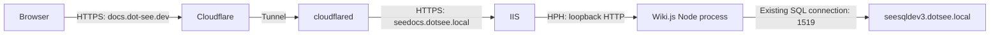

# Upgrade Wiki.js 2.x and move it to IIS

Operator guide for the Windows Server 2025 Standard design confirmed by the user in Q14 on 2026-10-13. Research date: 2026-10-13. These instructions are based on upstream documentation and source review; they have not been executed on this server. Complete the operator inventory and the acceptance checks before treating the deployment as verified. The accepted design is recorded in [ADR-0004](../adr/0004-wikijs-httpplatformhandler-hosting.md).

## Deployment values and sequence

| Item | Value |
| --- | --- |
| Current version and folder | Wiki.js v2.5.311, `C:\wiki` |
| Current startup | Task Scheduler launches a batch file containing `cd \`, `cd wiki`, `node server` |
| Current listener | Node HTTP on port 80; IIS is not yet installed |
| Upgrade destination | v2.5.316, the verified stable 2.x release on the research date |
| SQL Server | `seesqldev3.dotsee.local`, TCP port `1519` |
| New IIS site folder | `C:\inetpub\www-wikijs`, beside `wwwroot` |
| New process owner | IIS / HttpPlatformHandler (HPH), one Node instance |
| Public browser address | `https://docs.dot-see.dev/`, through the existing Cloudflare Tunnel |
| IIS HTTPS origin | `https://seedocs.dotsee.local` |
| Origin certificate | Reuse the available certificate after checking its coverage and trust |
| Sign-in | Wiki.js Google authentication; IIS does not authenticate the Google user |
| Maintenance | Planned downtime; upgrade first, IIS hosting change second |

The `.local` address is the tunnel's HTTPS origin and IIS binding name. Wiki.js's public **Site URL** remains `https://docs.dot-see.dev`; Google callbacks must also use that public address. The last hostname change is interpreted as changing the IIS origin, not the public Cloudflare hostname.

Use two separate maintenance steps. First upgrade the existing `C:\wiki` installation and verify it through the existing tunnel/task arrangement. Then move that upgraded application to IIS. Keep only one live application instance connected to the Wiki.js database.



## Operator inventory

Record these values before maintenance; they are not inferred from the SQL hostname or installation folder:

- The Task Scheduler task name/path, batch-file path, working directory, account, restart policy, and execution-time limit. Export its definition for recovery.
- The actual Node executable and version used by that task. An interactive user's PATH can differ from the task's PATH. The maintained Wiki.js v2 requirements list Node 22/24; if a runtime change is needed, plan and verify it separately from the application/hosting changes.
- The active `C:\wiki\config.yml`, SQL database name, SQL authentication method, and any environment variables the configuration references. Preserve SQL connection/TLS settings. Changing from the task's account to an IIS pool identity does not transfer Windows database credentials or environment variables automatically.
- Configured local storage locations, `dataPath`, sideloaded files, custom modules, and referenced certificates/secrets. Keep their backups restricted.
- The SQL-side backup destination and the DBA's restore procedure. A backup path on the SQL server is distinct from a path on this Windows web server.
- The Cloudflare connector location, management mode, current origin route, and rollback setting. Do not copy tunnel tokens into the guide or backup notes.
- The origin certificate thumbprint, private-key availability on the IIS server, SAN coverage for `seedocs.dotsee.local`, expiry, and the issuing chain trusted by the tunnel connector.

[Wiki.js requirements](https://github.com/requarks/wiki-docs-v2/blob/master/install/requirements.md), [version-specific source baseline](../../archive/research/nodejs-iis/wikijs-v2.5.311-baseline.md).

## Step 1: upgrade the existing installation

### Stage the exact 2.x Windows package

Use the Windows runtime archive from the explicit [v2.5.316 release](https://github.com/requarks/wiki-v2/releases/tag/v2.5.316):

`https://github.com/requarks/wiki-v2/releases/download/v2.5.316/wiki-js-windows.tar.gz`

Download and inspect/extract it to a separate staging folder, such as `C:\wiki-stage-v2.5.316`. Check the package version before replacing the live files. Use the runtime release artifact, not a source checkout or the 3.x beta.

The old Windows upgrade instructions use a moving `Requarks/wiki/releases/latest` download. That repository now carries the 3.x beta line. Do not use that moving URL for this 2.x upgrade. If executing this guide later, verify the newest stable 2.x release and review its changes before substituting another explicit version. [Upgrade research](../../archive/research/nodejs-iis/wikijs-v2-upgrade-research.md).

### Stop writes and establish a recovery point

Hold public access for the maintenance interval. Disable the Wiki.js scheduled task so it cannot restart during maintenance. Record the specific Wiki.js Node process and stop that process; do not terminate every `node.exe` on the server. Confirm that the old listener is gone and no Wiki.js instance is still writing to the database. The batch runs Node in the foreground, but verify the process tree rather than assuming that ending the task stopped everything.

Preserve the existing application directory, active config, exported task definition, batch file, referenced environment/secrets, and persistent filesystem locations. Keep the pre-upgrade copy separate from the new staging folder.

With Wiki.js stopped, have the DBA take a full SQL backup. In SSMS, the explicit connection target is `tcp:seesqldev3.dotsee.local,1519`. Replace the database and backup-path placeholders below; do not use the wiki folder as a SQL backup path unless it is an explicitly provisioned share accessible to the SQL Server service.

```sql
BACKUP DATABASE [<WikiDatabaseName>]
TO DISK = N'<SQLServerBackupDirectory>\Wiki_pre_v2.5.316_<timestamp>.bak'
WITH COPY_ONLY, CHECKSUM, STATS = 5;
GO

RESTORE VERIFYONLY
FROM DISK = N'<SQLServerBackupDirectory>\Wiki_pre_v2.5.316_<timestamp>.bak'
WITH CHECKSUM;
GO
```

The DBA needs backup permissions, and the SQL Server service identity needs access to the destination. `VERIFYONLY` checks backup readability/completeness; it is not a restore test. Use the established tested recovery procedure, or arrange an isolated restore check if recoverability is not already established. Preserve any database/backup encryption keys needed for recovery. [SQL Server recovery guidance](../../archive/research/nodejs-iis/sqlserver-upgrade-recovery.md).

### Replace files and restart under the existing task

Retain the v2.5.311 directory under a clearly named backup location. Place the staged v2.5.316 runtime files at `C:\wiki`, restore the active `config.yml`, and restore/reconnect the inventoried persistent files. Preserve the current port-80 configuration and tunnel origin during this first step. Do not copy the entire old runtime tree over the new package.

Correct the task launcher to use an explicit drive and executable. The Node path below is an example: replace it with the executable identified in the inventory, retaining a supported runtime.

```bat
@echo off
cd /d C:\wiki
"C:\Program Files\nodejs\node.exe" server
```

Re-enable/start the existing task. Watch startup and migration output. Verify v2.5.316, public pages, Google sign-in, expected permissions, a controlled edit/save, relevant media/storage access, and the WebSocket-backed features used by this wiki. Use a disposable page for the edit check. Release public access only after the checks pass.

Wiki.js warns that a previous application version cannot simply run against an upgraded database schema. If recovery requires returning to v2.5.311, stop the application and restore the pre-upgrade database **together with** the matching application, config, and persistent files. A directory-only downgrade is not a complete recovery procedure. [Official upgrade procedure](https://github.com/requarks/wiki-docs-v2/blob/master/install/upgrade.md).

## Step 2: install IIS and change hosting

### Stage the new folder and prepare the outage

After Step 1 succeeds, stage a separate copy of the upgraded runtime at `C:\inetpub\www-wikijs`. Retain the working `C:\wiki` installation at the same upgraded version for hosting recovery. Resolve relative filesystem-storage paths before moving the folder: they must still refer to the intended data, not accidentally create an empty replacement directory.

Hold public access again, disable the scheduled task, and stop its Wiki.js process. Confirm port 80 is free before installing/starting IIS: the old Node listener and IIS cannot own the same endpoint. Do not launch the staged copy against the live database while the old copy runs.

Install the IIS Web Server role, management tools, Request Filtering, WebSocket Protocol, and Application Initialization if using warm startup. Stop the newly created Default Web Site so the existing port-80 tunnel route cannot accidentally expose it during cutover. Install x64 HttpPlatformHandler v1.2 from Microsoft's [direct download page](https://www.iis.net/downloads/microsoft/httpplatformhandler), following its prerequisites; use the direct installer rather than Web Platform Installer. Confirm the module is registered before configuring the application. HPH's published compatibility/support statements do not specifically prove this Wiki.js deployment on Server 2025. [Component evidence](../../archive/research/nodejs-iis/component-maintenance.md).

Create a dedicated IIS site/application pool, for example `WikiJs`, with physical path `C:\inetpub\www-wikijs`, x64 mode, and **No Managed Code**. Configure Anonymous Authentication for Wiki.js requests; Google sign-in belongs to Wiki.js. Bind HTTPS port 443 with hostname **`seedocs.dotsee.local`**, SNI, and the verified existing certificate.

Grant the pool identity read/execute on the runtime and read on its config. Grant write access only to the configured Wiki.js data/storage locations and its restricted log folder, for example `C:\ProgramData\WikiJs\logs`. Provision that folder before starting HPH. Preserve SQL credentials securely; if the installation uses Windows-integrated database access, provision a suitable worker identity/database access rather than assuming the former task identity carries over.

### Make the Wiki.js listener accept HPH's assigned port

In the staged application's `config.yml`, change only the relevant listener settings, preserving database and other application configuration:

```yaml
port: $(HTTP_PLATFORM_PORT)
bindIP: 127.0.0.1
```

Keep Wiki.js's own HTTPS disabled for this topology: the tunnel-to-IIS hop uses HTTPS, and HPH forwards to the Node listener over local HTTP. Wiki.js replaces environment expressions before parsing YAML; its default positive port does not automatically honor `PORT`. [Pinned configuration helper](https://github.com/Requarks/wiki-v2/blob/v2.5.316/server/helpers/config.js), [HPH reference](https://learn.microsoft.com/en-us/iis/extensions/httpplatformhandler/httpplatformhandler-configuration-reference).

Wiki.js derives its application root from the process working directory. HPH does not document a working-directory attribute. Create `C:\inetpub\www-wikijs\iis-start.js` as a same-process bootstrap:

```js
process.chdir(__dirname);
require('./server');
```

Place the following candidate `web.config` in that folder, replacing the Node path with the inventoried executable. The startup/request timeout values are initial values to verify, not measured guarantees.

```xml
<?xml version="1.0" encoding="utf-8"?>
<configuration>
  <system.webServer>
    <handlers>
      <clear />
      <add name="httpplatformhandler" path="*" verb="*"
           modules="httpPlatformHandler" resourceType="Unspecified" />
    </handlers>
    <httpPlatform processPath="C:\Program Files\nodejs\node.exe"
                  arguments="&quot;C:\inetpub\www-wikijs\iis-start.js&quot;"
                  startupTimeLimit="120" startupRetryCount="3"
                  requestTimeout="00:05:00" processesPerApplication="1"
                  stdoutLogEnabled="true"
                  stdoutLogFile="C:\ProgramData\WikiJs\logs\httpplatform-stdout">
      <recycleOnFileChange>
        <file path=".\config.yml" />
        <file path=".\iis-start.js" />
      </recycleOnFileChange>
    </httpPlatform>
    <security>
      <requestFiltering>
        <hiddenSegments>
          <add segment="config.yml" />
          <add segment="config.sample.yml" />
          <add segment="node_modules" />
          <add segment=".git" />
        </hiddenSegments>
      </requestFiltering>
    </security>
  </system.webServer>
</configuration>
```

The wildcard HPH handler gives Wiki.js ownership of request handling. Keep the inherited IIS protection for `web.config`; do not clear the hidden-segment filters. Keep startup logs restricted and configure ongoing log retention after verification.

Use one pool worker and one HPH process. If preventing concurrent instances during recycling, configure IIS to disallow overlapping pool rotation; `processesPerApplication="1"` alone does not prevent old/new worker overlap. Warm startup uses the pool's `AlwaysRunning` mode and the application's preload setting, with Application Initialization; disable pool idle termination if continuous availability is intended. These settings do not prove graceful Wiki.js shutdown. Verify cold start, recycle, stop/start, and reboot recovery. [Implementation contract](../../archive/research/nodejs-iis/httpplatformhandler-implementation-contract.md).

### Change Cloudflare Tunnel to the HTTPS origin

Keep the tunnel's public hostname `docs.dot-see.dev`. Its origin service should be `https://seedocs.dotsee.local:443`, provided that name resolves to the IIS machine from the connector. The existing certificate must cover `seedocs.dotsee.local` and its chain must be trusted by that connector.

Set the origin TLS server name to `seedocs.dotsee.local` and the HTTP Host header to `seedocs.dotsee.local` for the IIS origin binding. Keep TLS verification enabled. If the existing certificate uses a private issuer that the connector does not trust, provide that CA trust through the supported connector configuration; do not use `noTLSVerify: true` as the deployment solution.

For a locally managed tunnel, update only the relevant ingress rule, retaining the actual tunnel identity, credential-file setting, other routes, and catch-all:

```yaml
ingress:
  - hostname: docs.dot-see.dev
    service: https://seedocs.dotsee.local:443
    originRequest:
      originServerName: seedocs.dotsee.local
      httpHostHeader: seedocs.dotsee.local
      noTLSVerify: false
      # caPool: C:\Cloudflare\origin-ca-chain.pem  # only if required
  # Preserve the existing other routes and final catch-all here.
```

For a dashboard-managed tunnel, open **Networking → Tunnels → the existing tunnel → Routes → Edit route**, and edit that public hostname's service to HTTPS and the IIS origin address/443. Set **Origin Server Name** to `seedocs.dotsee.local`, **HTTP Host Header** to `seedocs.dotsee.local`, and leave certificate-verification disabling off. If needed, **CA Pool** is the path to a PEM/CRT CA bundle on the connector machine; it is not an upload to the dashboard. Provision that file where the connector can read it before selecting the path. Use the management mode that owns the current tunnel; do not paste the YAML example into a dashboard-managed tunnel. [Cloudflare origin parameters](https://developers.cloudflare.com/cloudflare-one/networks/connectors/cloudflare-tunnel/configure-tunnels/origin-parameters/).

If the connector runs on the IIS machine, `https://127.0.0.1:443` is another service-address option, still using `seedocs.dotsee.local` for TLS/SNI and HTTP Host. If it runs elsewhere, loopback refers to that other machine and must not be used. Do not use the public Tunnel/CNAME hostname as the origin service address. [Cloudflare HTTPS origins](https://developers.cloudflare.com/tunnel/troubleshooting/https-origins/), [origin configuration research](../../archive/research/nodejs-iis/cloudflare-tunnel-iis-https.md).

### Verify before releasing access

Keep Wiki.js's Administration → General → **Site URL** at `https://docs.dot-see.dev`. Verify the Google strategy's generated callback and its registered Google redirect URI use the public `.dev` address. Do not replace either with `seedocs.dotsee.local`. Keep existing authentication configuration; the old Google setup documentation includes a retired Google+ API instruction, which is not a current prerequisite. [Wiki.js Google provider](https://docs.requarks.io/auth/google), [application research](../../archive/research/nodejs-iis/wikijs-requirements.md).

Verify through the actual public tunnel route:

- HTTPS origin connection succeeds with certificate verification on; IIS selects the intended site.
- Browser redirects, canonical links, and Google callbacks remain on `https://docs.dot-see.dev`; sign-in/sign-out and expected permissions work.
- Pages, a disposable edit/save, applicable media/storage, and GraphQL WebSocket subscriptions at `/graphql-subscriptions` work. HPH WebSocket behavior is not established by the configuration reference and must pass this check before accepting the topology.
- Config/source paths such as `/config.yml` and `/web.config` are blocked rather than served.
- Pool recycling, stop/start, and reboot recover with one Wiki.js instance, the task disabled, and no fixed-port-80 Node process returning. Observe shutdown/in-flight behavior; do not claim interruption-free recycling.

Wiki.js's broad Trust Proxy setting is not a certificate or callback fix. Preserve/review its existing setting and ensure trusted ingress handles forwarded headers correctly before enabling broad trust. Public Site URL controls the Google callback in the reviewed source; actual public login and cookie behavior must still be checked.

If HPH cannot satisfy the acceptance checks, pause the hosting cutover and return to the working upgraded installation. Choosing ARR/service supervision or YARP is a new architecture decision, not an automatic substitution.

### Recover from a failed hosting cutover

Hold public access, stop the IIS Wiki.js site/pool, and verify its Node child is gone. Restore the previous tunnel origin setting and the upgraded `C:\wiki` task/configuration, freeing port 80 from IIS first if needed. Run only that retained upgraded instance. Because both hosting copies use v2.5.316, this is hosting recovery, not an application/database downgrade.

Restore the pre-upgrade database only if returning to v2.5.311 is required, with its matching files. Restoring that earlier database can discard edits made since the backup; this is why the maintenance steps hold user access through verification.
